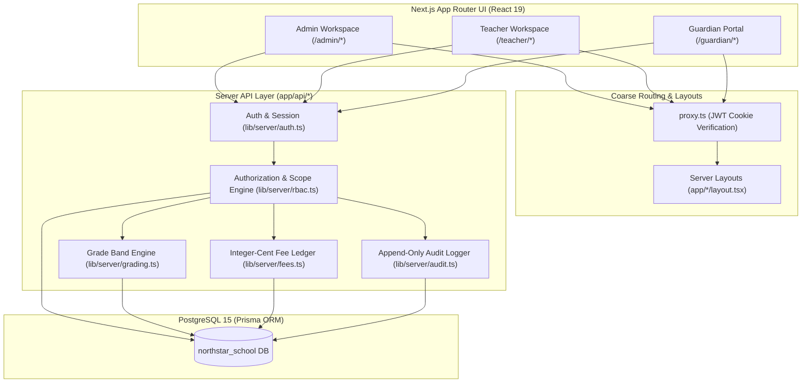
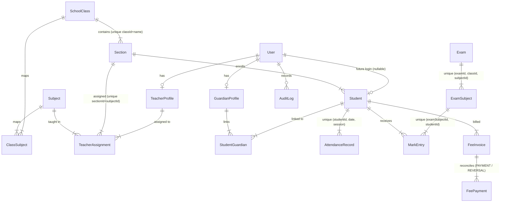

# Northstar School Management System — Architecture & Security Design

## 1. System Architecture

Northstar is a unified full-stack Next.js 16 (App Router) application backed by PostgreSQL 15 and Prisma ORM. All client workspaces (`Admin`, `Teacher`, `Guardian`) communicate with server-side Route Handlers under `app/api/*`, which enforce authentication, CSRF verification, Zod input validation, role-based access control (RBAC), and relational scope isolation before querying PostgreSQL.

---

## 2. Database Schema & Entity Relationships

The Prisma schema (`prisma/schema.prisma`) models the school's academic structure, people, attendance, examinations, fee ledger, and immutable audit trail using strict foreign keys, composite unique constraints, and indexes.

### Key Schema Invariants
- **Single-Class Sections:** `Section` has a mandatory non-nullable foreign key `classId` referencing `SchoolClass` with `@@unique([classId, name])`. A section belongs to exactly one class.
- **Attendance Uniqueness:** `AttendanceRecord` enforces `@@unique([studentId, date, session])` with `@db.Date` and default session `'DAILY'`.
- **Exam Paper Uniqueness:** `ExamSubject` enforces `@@unique([examId, classId, subjectId])` and `MarkEntry` enforces `@@unique([examSubjectId, studentId])`.
- **Future Student Login Ready:** `Student.userId` is an optional unique foreign key to `User.id`, allowing student accounts to be enabled in the future without altering any existing table or foreign key.

---

## 3. Authentication, Session & Security Model

### Password Hashing & Session Signing (`lib/server/auth.ts`)
- Passwords are hashed using `bcryptjs` (cost factor 10).
- Upon login (`POST /api/auth/login`), the server issues an HS256-signed JWT (`jose`) stored in an `httpOnly`, `sameSite=lax`, `secure` (in production) cookie named `northstar-session`.
- On every API request and server layout render, `getRequestSession()` verifies the JWT signature **and** checks the `User` row in PostgreSQL to ensure the user is still `ACTIVE` and their role has not changed.

### CSRF Protection & Rate Limiting
- **CSRF:** Login sets a readable `northstar-csrf` token cookie paired with the signed `csrfToken` claim inside the JWT. State-changing requests (`POST`, `PUT`, `PATCH`, `DELETE`) verify the `x-csrf-token` header and/or `Origin` vs `Host` match in `verifyCsrf()`.
- **Rate Limiting:** `POST /api/auth/login` tracks failed login attempts by `IP + email` over a 10-minute sliding window, returning `429 Too Many Requests` when exceeded.
- **Self-Privilege Escalation Prevention:** `PATCH /api/profile` explicitly rejects any payload containing `role` or `status` with `403 Forbidden`.

---

## 4. Central Authorization & Scope Isolation (`lib/server/rbac.ts`)

Every API route handler calls `requireSession(request, allowedRoles)` and role-specific scope helpers:
- **`401 Unauthorized`:** Returned when no valid signed session is present.
- **`403 Forbidden`:** Returned when the authenticated user's role is not permitted for the endpoint (e.g., a Teacher requesting `/api/fees/invoices` or `/api/teachers`, or a Guardian posting to `/api/students`).
- **`404 Not Found` (Anti-Enumeration Scope Isolation):**
  - **Teacher Scope (`getTeacherScope`, `assertTeacherSectionScope`, `assertTeacherStudentScope`):** Derived strictly from `TeacherAssignment` rows in PostgreSQL. If a teacher requests or submits data for a section, class, or student outside their assigned sections, the server returns `404 Not Found`. Teachers are also stripped of guardian contact details on student payloads and blocked from all fee endpoints.
  - **Guardian Scope (`getGuardianScope`, `assertGuardianStudentScope`):** Derived strictly from `StudentGuardian` links in PostgreSQL. Requesting another family's student ID or invoice returns `404 Not Found`.

---

## 5. Domain Subsystems

### Attendance Engine (`/api/attendance`)
- Enforces `@@unique([studentId, date, session])` at both the PostgreSQL level and API layer (`409 Conflict` when `allowUpdate` is `false`).
- Teachers can record or update attendance **only for the current UTC date** and **only for their assigned sections**.
- Modifying historical attendance requires `ADMIN` role and a mandatory `editReason` (minimum 3 characters), which is persisted on the `AttendanceRecord` and logged in `AuditLog`.

### Examination, Marks & Configurable Grade Bands (`/api/exams`, `/api/marks`, `/api/results`, `/api/grade-bands`)
- Marks are validated against `[0, examSubject.maxMarks]` via Zod and server checks (`400 Bad Request` on negative or above-maximum marks).
- Workflow states: `DRAFT` → `SUBMITTED` → `PUBLISHED`.
- **Visibility Rule:** Guardians querying `/api/results` or `/api/exams` only ever receive records where `status === 'PUBLISHED'`.
- **Locking Rule:** Publishing an exam sets `locked = true` and transitions all marks to `PUBLISHED`. Any subsequent attempt to edit marks is rejected with `403 Forbidden` unless an Admin unlocks the exam via `PATCH /api/exams` with `{ action: 'UNLOCK', reason: '...' }`.
- **Grade Band Calculation (`lib/server/grading.ts`):** Percentage, letter grade (`A+`, `A`, `A−`, `B+`, `B`, `C`, `D`, `F`), GPA points, and pass/fail status are computed dynamically from the `GradeBand` table—never hardcoded.

### Financial Ledger & Concurrency Safety (`/api/fees/invoices`, `/api/fees/payments`, `lib/server/fees.ts`)
- All monetary values are stored in integer minor units (`totalCents`, `amountCents`), eliminating floating-point rounding drift.
- Payments are immutable (`FeePayment` rows are never updated or deleted). Corrections create a `REVERSAL` entry linked via `reversedPaymentId` with a mandatory `reversalReason`.
- **Concurrency & Reconciliation:** Recording a payment runs inside a `Prisma.TransactionIsolationLevel.Serializable` transaction that executes `SELECT id FROM "FeeInvoice" WHERE id = ... FOR UPDATE`. It sums existing `PAYMENT` minus `REVERSAL` entries, rejects overpayments (`amountCents > remainingCents`) with `400 Bad Request`, inserts the new payment, and derives the invoice's `status` (`UNPAID`, `PARTIAL`, `PAID`) so `paidCents + outstandingCents === totalCents` is an invariant at all times.
